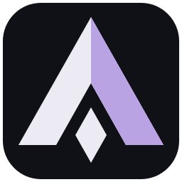

<p align="center"></p>

# Âmago Free

**Escreva, organize e conecte suas ideias. Gratuitamente, com código aberto e arquivos locais.**

O Âmago Free é uma edição mais simples e com recursos limitados do [Âmago](https://amagoapp.com). É um aplicativo de escrita e organização de conhecimento, com editor Markdown, biblioteca pessoal e projetos que usam pastas reais do computador.

Esta edição é uma base estável: recebe **correções quando necessário**, sem compromisso de incorporar novos recursos da edição oficial. Não possui conta, marketplace, instalação ou execução de plugins, nem serviços de nuvem. Esses componentes não fazem parte deste repositório.

[Baixar para Windows](https://github.com/Nixye/amago-free/releases/latest) · [Reportar um problema](https://github.com/Nixye/amago-free/issues) · [Conhecer a edição oficial](https://amagoapp.com) · [Comunidade no Discord](https://discord.gg/v5eQyB2E6f)

## O que está incluído

- Editor Markdown com leitura, edição e prévia; tabelas, tarefas, links e imagens locais.
- Biblioteca pessoal com documentos recentes, favoritos, pastas e tarefas. A lixeira restaura documentos e pastas do espaço pessoal. Em projetos locais, abra **Coleções → Lixeira do projeto** para restaurar itens ou confirmar a exclusão definitiva.
- Projetos em pastas locais, com leitura e gravação de arquivos Markdown e texto.
- Busca por nome e conteúdo, tags, menções e propriedades.
- Links entre notas, referências de retorno e mapa de conexões.
- Modo foco, documentos lado a lado, navegação por títulos e estatísticas de escrita.
- Paletas nativas, preferência de tema claro/escuro, ajustes de tipografia e acrílico em versões compatíveis do Windows.
- Exportação da biblioteca e importação de notas e backups compatíveis.
- Ferramentas Git locais, quando o Git está instalado; autenticação remota fica a cargo do Git do sistema.

## Free e edição oficial

| Aspecto | Âmago Free | Âmago oficial |
| --- | --- | --- |
| Código | Público, GPL-3.0-only | Repositório privado |
| Evolução | Correções quando necessário | Desenvolvimento contínuo |
| Escrita e arquivos locais | Sim | Sim |
| Conta e perfis | Não | Disponíveis |
| Marketplace e plugins | Não | Disponíveis |
| Projetos em nuvem | Não | Serviço opcional com assinatura própria |
| Atualizações | Manuais, pelas releases deste projeto | Site e atualizador do Âmago |

As edições compartilham a identidade visual, mas têm identificadores de instalação e armazenamento separados. É possível manter ambas instaladas. O Free nunca baixa nem instala automaticamente o executável oficial.

## Instalação no Windows

1. Acesse a [última release](https://github.com/Nixye/amago-free/releases/latest).
2. Baixe `Amago-Free-<versão>-Setup-x64.exe` para instalar ou `Amago-Free-<versão>-Portable-x64.exe` para executar sem instalação.
3. Abra o aplicativo e escolha **Meu universo** ou **Abrir pasta**.

Os binários são para Windows x64 e não possuem certificado comercial de assinatura de código. O Windows pode mostrar um aviso de aplicativo desconhecido. Verifique a origem do download e, se desejar, compare seu SHA-256 com o arquivo `SHA256SUMS.txt` da mesma release:

```powershell
Get-FileHash .\Amago-Free-1.0.0-Setup-x64.exe -Algorithm SHA256
```

Para atualizar, feche o aplicativo e execute o novo instalador Free. Na edição portátil, substitua o executável. Faça backup antes de uma atualização. Não existe consulta automática de versões em segundo plano. O menu **Configurações → Sobre o Free** contém os links para versões e código.

## Biblioteca, mapa e exportação

- **Etiquetas** adiciona ou remove tags das propriedades da nota. Tags escritas no corpo aparecem junto das propriedades. Digite parte de um nome na busca ou use `#` para receber sugestões de etiquetas.
- **Resumo**, no topo da janela, mostra as contagens da visualização atual. Nos documentos, inclui o tempo de leitura.
- No menu de um arquivo ou pasta, **Excluir definitivamente** mostra o conteúdo afetado antes da confirmação. Em **Coleções → Lixeira**, pesquise por nome ou pasta e escolha restaurar ou excluir uma nota.
- No mapa, **Aparência** reúne a organização, o traçado, o tamanho dos pontos e a exibição de nomes. **Enquadrar** mostra os pontos visíveis, inclusive depois de arrastá-los. Grupos densos de tags ou menções mostram uma amostra dos vínculos.
- **Exportar** oferece PDF e imagem PNG. No editor, também é possível salvar o Markdown ou o texto original. O mapa dispõe de SVG vetorial. Documentos longos exportados como imagem são divididos em PNGs numerados dentro de um ZIP.
- Em **Configurações → Edição** e **Visualização**, ajuste o tamanho do texto entre 10 e 48 px.

## Primeiros passos

**Meu universo** guarda a biblioteca pessoal no perfil do aplicativo. Crie uma nota, dê um título e escreva em Markdown. Use `[[Nome da nota]]` para conectar ideias, `#tags` para agrupá-las e a busca para encontrá-las. O mapa mostra relações entre os documentos.

**Abrir pasta** trabalha diretamente em uma pasta que você escolhe. Você pode abrir uma biblioteca Markdown existente ou criar uma pasta vazia no Explorador do Windows e abri-la no Âmago Free. Os arquivos continuam sendo seus arquivos comuns, acessíveis por outros editores.

| Atalho | Ação |
| --- | --- |
| `Ctrl K` | Buscar |
| `Ctrl N` | Nova nota |
| `Ctrl S` | Salvar arquivos abertos |
| `Ctrl Shift D` | Adicionar nota lado a lado |
| `Ctrl Shift P` | Paleta de comandos |
| `Esc` | Fechar diálogo |

Outros atalhos e preferências estão nas configurações. A abertura de um projeto existente não importa os arquivos para um serviço remoto.

## Dados, privacidade e backups

- No Windows, a biblioteca pessoal fica normalmente em `%APPDATA%\amago-free\vault.json`. Use **Configurações → Dados → Abrir pasta de dados** para encontrar o diretório efetivo.
- Antes de substituir a biblioteca, o aplicativo preserva uma cópia diária anterior na subpasta `backups`. Isso não substitui uma rotina de backup externa.
- Arquivos de projetos são salvos na pasta original. O aplicativo verifica alterações externas antes de gravar. Faça cópias de segurança dessas pastas separadamente.
- **Exportar espaço (.json)** exporta a biblioteca pessoal; não inclui os arquivos de projetos. Importe esse backup ou arquivos Markdown pela opção **Importar notas**.
- A edição portátil dispensa instalação, mas ainda usa o perfil do usuário para biblioteca e preferências; ela não é um cofre autocontido no pendrive.
- Na prévia web, os dados ficam no armazenamento do navegador. Apagar os dados do site pode apagá-los. Acesso a pastas depende de suporte e permissão do navegador.
- Não há login do Âmago, telemetria, sincronização ou conexão aos serviços de conta da edição oficial. Fontes são incluídas localmente. Links externos só são abertos por você; ações Git remotas usam a rede e as credenciais do Git configurado no computador.
- Backups e arquivos não são criptografados pelo aplicativo. Proteja o acesso ao seu usuário do sistema.

Para migrar entre as edições, exporte e importe a biblioteca ou abra a mesma pasta Markdown. Evite editar simultaneamente o mesmo arquivo nos dois aplicativos.

## Executar a partir do código

Requisitos: **Node.js 24 LTS**, npm e Git. O desenvolvimento e a distribuição de referência são para Windows x64; outras plataformas não têm binários oficiais nem validação equivalente neste projeto.

```powershell
git clone https://github.com/Nixye/amago-free.git
cd amago-free
npm ci
npm start
```

Não é necessário criar conta, configurar `.env`, chave de API, banco de dados ou backend.

Para experimentar a interface no navegador:

```powershell
npm run web
```

Abra o endereço impresso no terminal. Recursos nativos, como Git, janela do Windows e armazenamento no perfil do Electron, dependem da versão desktop.

## Testes e compilação

```powershell
npm test
npm run test:features
npm run test:visual
npm run dist:win
```

Os testes cobrem Markdown, busca, arquivos locais, conflitos de gravação, navegação, edição, temas e a separação da edição Free. Os testes de interface usam Electron com perfis temporários.

O build gera instalador e portátil na pasta `release/`. `dist/` contém o código-fonte da interface em JavaScript/CSS/HTML, apesar do nome convencional de pasta de saída. Não há etapa de bundling do frontend.

| Pasta | Conteúdo |
| --- | --- |
| `dist/` | Interface e módulos da aplicação |
| `desktop/` | Processo Electron, bridge restrita e operações de arquivos |
| `scripts/` | Sincronização de versão e verificações de distribuição |
| `tests/` | Testes unitários, integração e interface |
| `.github/workflows/` | Validação e releases da edição Free |

## Comunidade e ajuda

Entre no [Discord oficial do Âmago](https://discord.gg/v5eQyB2E6f) para tirar dúvidas, compartilhar projetos e conversar no canal da edição Free. No aplicativo, abra **Configurações → Sobre o Free** ou pressione **Ctrl Shift P** e busque **Discord**. O convite abre no navegador; participar do servidor é opcional e não conecta seus arquivos locais ao Discord.

## Manutenção e contribuições

Este projeto é mantido de forma pontual. Não há calendário de lançamentos nem garantia de prazo de resposta. São bem-vindas correções reproduzíveis, melhorias de documentação e ajustes de acessibilidade que preservem o escopo simples desta edição.

Ao reportar um bug, inclua versão do Free, versão do Windows, passos para reproduzir e comportamento esperado. Remova notas pessoais, tokens, caminhos sensíveis e dados privados dos exemplos. Antes de propor novos recursos amplos, abra uma discussão em uma issue: paridade com a edição oficial não é um objetivo deste repositório.

Pull requests devem incluir a correção e a validação adequada. Não acrescente conta, marketplace, carregador de plugins ou dependência dos serviços privados do Âmago. Use os mesmos termos de licença do projeto nas contribuições.

Releases de manutenção usam tags `v<versão>` correspondentes a `package.json`, por exemplo `v1.0.1`. O workflow valida, compila e anexa os binários e checksums à release; o código-fonte correspondente fica disponível na própria tag. Não existe sincronização automática de código com o repositório privado.

## Licença e créditos

Copyright © 2026 Luna. O código e os recursos originais desta edição são distribuídos sob **GNU General Public License, versão 3 somente (`GPL-3.0-only`)**. Consulte o texto integral em [LICENSE](LICENSE). Dependências e fontes conservam suas próprias licenças, indicadas em [THIRD_PARTY_NOTICES.md](THIRD_PARTY_NOTICES.md).

O aplicativo é fornecido sem garantia, conforme a licença. A licença de copyright não concede direitos de marca: distribuições modificadas devem identificar claramente suas alterações e não sugerir endosso da edição oficial. A identidade Âmago é compartilhada pelas duas edições mantidas por Luna.

### Configurações e navegação revisadas

Use **Edição** para fonte, espaçamento, quebra de linha e ortografia do editor, e **Visualização** para tamanho, espaçamento e largura da leitura. **Atalhos** permite pesquisar e personalizar 17 combinações; conflitos são indicados antes de salvar. **Atualizações** oferece a opção marcada por padrão para consultar novas versões ao iniciar.

O menu de contexto dos documentos oferece **Abrir ao lado**. Arraste uma nota ou texto do explorador para uma metade do editor para escolher o lado; a área de destino fica destacada. Até quatro colunas são preservadas na sessão.

No mapa, busca e relações ficam juntas; **Aparência** reúne organização, nomes e animação. A vizinhança percorre toda a rede conectada antes de aplicar a busca, mantendo os caminhos através de notas ocultas. O enquadramento inclui todas as notas indexadas que correspondem ao filtro.
